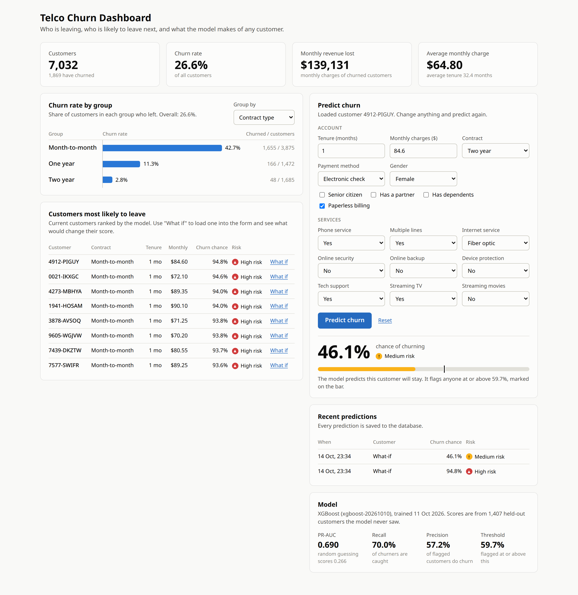
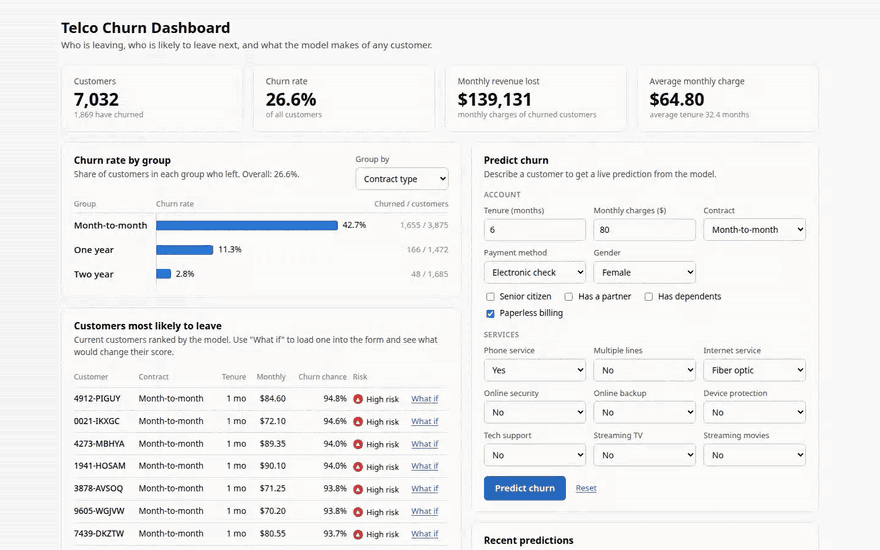
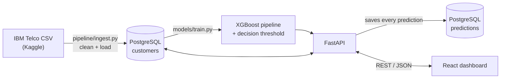
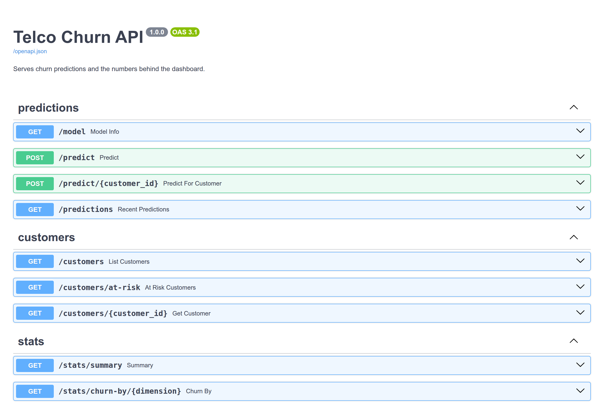

# Telco Customer Churn Dashboard

[](https://github.com/LAKWAN194/telco-churn-dashboard/actions/workflows/ci.yml)


**Find the telecom customers who are about to leave, and test what would keep them.**

An end-to-end ML system built on the IBM Telco dataset: a data pipeline loads
7,032 customers into PostgreSQL, an XGBoost model is trained on them, a FastAPI
backend serves predictions, and a React dashboard shows who is leaving, who is
likely to leave next, and what would change their minds.



## What it does

- **See who is leaving.** Headline numbers, plus churn rate by contract, tenure,
  internet service, payment method or tech support.
- **Find who is next.** Current customers ranked by the model's churn probability.
- **Ask "what if?"** Load any at-risk customer into the form, change their
  contract or services, and get a live prediction.
- **Keep a record.** Every prediction is saved with the model version and
  threshold that produced it.

### What if?

<p align="center">
  
</p>

Customer 4912-PIGUY is one month into a month-to-month fibre contract, with a
94.8% chance of churning. Moving them to a two-year contract with tech support
drops that to 46.1%, below the 59.7% threshold at which the model flags a customer.

## How it works



## Stack
- Python, pandas, scikit-learn, XGBoost
- FastAPI + PostgreSQL
- React (Vite)

## Project Structure
- `pipeline/` — data download, cleaning and loading into PostgreSQL
- `models/` — training and evaluation scripts, plus the saved model artifact
- `backend/` — FastAPI REST API
- `frontend/` — React dashboard
- `db/` — PostgreSQL schema
- `notebooks/` — exploratory data analysis
- `tests/` — unit tests for the pipeline, the model and the API

## Model

`models/train.py` compares a logistic regression and an XGBoost classifier on
cross-validated PR-AUC and keeps the better one. Accuracy is not used: only about
a quarter of customers churn, so a model that never predicts churn would still be
73% accurate (see `notebooks/01_eda.ipynb`). Both models are weighted for the
imbalance, and `total_charges` is left out because it is roughly
`tenure x monthly_charges`.

Results on the 1,407 held-out customers (20% of the data):

| Metric | Score |
| --- | --- |
| PR-AUC | 0.690 (random guessing: 0.266) |
| ROC-AUC | 0.853 |
| Recall | 0.70 |
| Precision | 0.57 |

The chosen model was XGBoost (cross-validated PR-AUC 0.660, against 0.647 for
logistic regression), with a decision threshold of 0.60 picked to maximise F1 on
out-of-fold predictions from the training data. The test set is used once, for
the final scores. Of the 374 test customers who actually churned, the model
flags 262; of the 458 it flags, 262 do churn.

# Setup

## Database Setup

### Prerequisites
- [Docker Desktop](https://www.docker.com/products/docker-desktop/) installed and running

### 1. Configure environment variables
```bash
cp .env.example .env
```

### 2. Start the database
```bash
docker compose up -d
```

To view startup logs:
```bash
docker compose logs db
```

### 3. Verify it's running
```bash
docker compose ps
docker compose exec db psql -U postgres -d telco_churn -c "\dt"
```
You should see the `customers` and `predictions` tables listed.

### 4. Stop or reset
```bash
docker compose stop        # stop, keep data
docker compose down        # stop and remove container, keep data
docker compose down -v     # full reset — deletes all data
```

## Python environment

```bash
python -m venv .venv
source .venv/bin/activate        # Windows: .venv\Scripts\activate
pip install -r requirements.txt -r backend/requirements.txt
```

## Load the data

```bash
python pipeline/download.py      # fetches the CSV from Kaggle into data/raw/
python pipeline/ingest.py        # cleans it and loads it into the customers table
```

`ingest.py` appends to the table, so run it once. To load again from scratch,
reset the database first with `docker compose down -v` and `docker compose up -d`.

## Train the model

```bash
python models/train.py           # reads customers from the database
python models/evaluate.py        # re-scores the saved model on the test set
```

Add `--source csv` to `train.py` to train straight from the raw CSV without a
database. The model is saved to `models/artifacts/churn_model.joblib`, with its
test metrics beside it in `metrics.json`.

## Run the API

```bash
uvicorn backend.main:app --reload
```

The API runs at http://localhost:8000, with interactive docs at
http://localhost:8000/docs.

| Method | Route | Description |
| --- | --- | --- |
| `GET` | `/health` | Database and model status |
| `GET` | `/model` | The serving model and its test metrics |
| `POST` | `/predict` | Predict churn for customer details in the request body |
| `POST` | `/predict/{customer_id}` | Predict churn for a stored customer |
| `GET` | `/predictions` | Most recent predictions |
| `GET` | `/customers` | Page through customers, with `search`, `limit` and `offset` |
| `GET` | `/customers/at-risk` | Current customers most likely to churn |
| `GET` | `/customers/{customer_id}` | One customer |
| `GET` | `/stats/summary` | Headline numbers |
| `GET` | `/stats/churn-by/{dimension}` | Churn rate by `contract_type`, `tenure_band`, `internet_service`, `payment_method` or `tech_support` |

Every prediction is saved to the `predictions` table with the model version and
threshold that produced it.

<p align="center">
  
</p>

## Run the dashboard

```bash
cd frontend
npm install
npm run dev
```

Open http://localhost:5173. The dashboard expects the API at
http://localhost:8000; to change that, copy `frontend/.env.example` to
`frontend/.env` and edit `VITE_API_URL`.

## Tests

```bash
pytest
```

The tests use synthetic data and an in-memory SQLite database, so they need
neither the raw CSV nor a running PostgreSQL.
