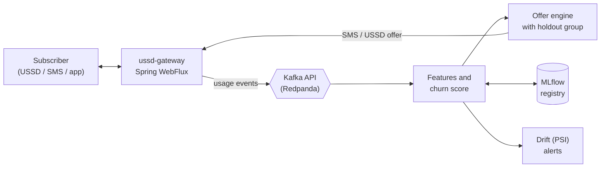

# Project brief: from churn model to retention loop

## The problem

The dashboard predicts who will leave. A telco needs more than that: it needs to
**act** on the prediction, on the channels its customers actually use, and to know
whether acting helped. In Sri Lanka those channels are USSD menus (`*123#`), which
work on any phone with no data, and SMS.

This upgrade turns the churn model into a closed loop:

Usage events stream in, features and a churn score follow, and the offer engine
sends a retention offer by SMS or USSD. A **randomly chosen holdout group** gets no
offer, so the effect of offers is measured, not assumed. Retraining goes through
MLflow, and a drift metric raises an alert when the customers change.

The diagram shows the plan. Where each box lives (in the existing API or as new
services) is ADR-001.

## What it is, and what it is not

| It is | It is not |
| --- | --- |
| A simulator of operator APIs, shaped like Ideamart's USSD, SMS and charging APIs | Connected to a real operator, or able to charge anyone |
| A closed loop with a measured, randomised holdout | A claim that offers work without evidence |
| Deployed to Kubernetes on a laptop (kind), with dashboards and alerts | A production telco system |

## Scope

- **USSD menu** (`*123#`-style) as a finite-state machine with session timeouts:
  the kernel you write by hand.
- **SMS OTP login**, rate-limited.
- **Bundle purchases** through mock carrier billing, with idempotent debits.
- **Usage events** on Kafka, turned into features and a churn score.
- **Per-subscriber reasons** for each score (SHAP).
- **Retention offers** by SMS or USSD, with a **holdout group** and measured uplift.
- **MLflow** tracking and registry; a **retraining pipeline**; a **drift metric**
  (PSI) with an alert.
- **Prometheus and Grafana** dashboards: latency, score distribution, drift.
- **kind and Helm** deployment.
- A **Jetpack Compose self-care app**: balance, bundles, offer inbox, offline cache.

## Non-goals

- Real network integration, real charging, or real subscriber data.
- Voice (IVR) and location-based services, though Ideamart offers both.

## What "done" means

- The holdout comparison reports uplift **with a confidence interval**, from ____
  simulated subscribers.
- p95 USSD reply latency is under ____ ms during the load test.
- A drift alert fires when the simulated population shifts, and not before.
- `helm install` on a fresh kind cluster brings up the whole loop.
- You can answer every question in [interview-prep.md](interview-prep.md) without notes.

## Who this is aimed at

| Employer | What they look for that this project shows |
| --- | --- |
| Dialog | AI and ML fundamentals in depth, on "one project" |
| hSenid Mobile | USSD gateways, SMSC, SDP, CPaaS (Ideamart is theirs) |
| Axiata Digital Labs | Spring WebFlux, Kafka, Kubernetes |
| SLT Digital Lab | AI and ML research internships |
| iTelaSoft | Telco software |
| Sysco LABS (SRE track) | Monitoring, deployment, reliability |
| PickMe | Jetpack Compose |

Sources are in the research report, `reports/Sri Lanka tech internships and projects.md`.

## Ground rules

1. **Design before code**, then get the design critiqued.
2. **Hand-write the kernel**: the USSD menu state machine
   ([design/ussd-menu.md](design/ussd-menu.md)).
3. **Measure the loop**: no claim about offers without the holdout comparison.
4. **Never merge code you cannot explain line by line.**
5. **Commit small, with your own messages.**
6. **Keep the decision log** in [interview-prep.md](interview-prep.md).
